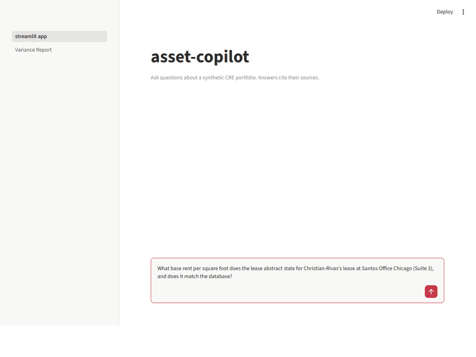
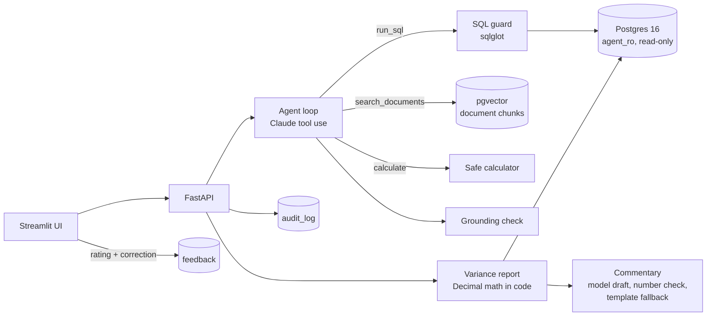
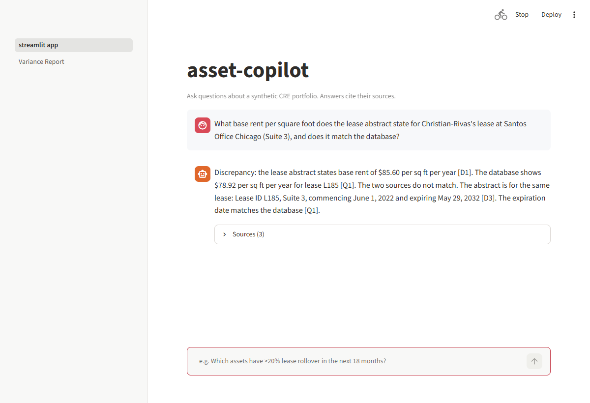
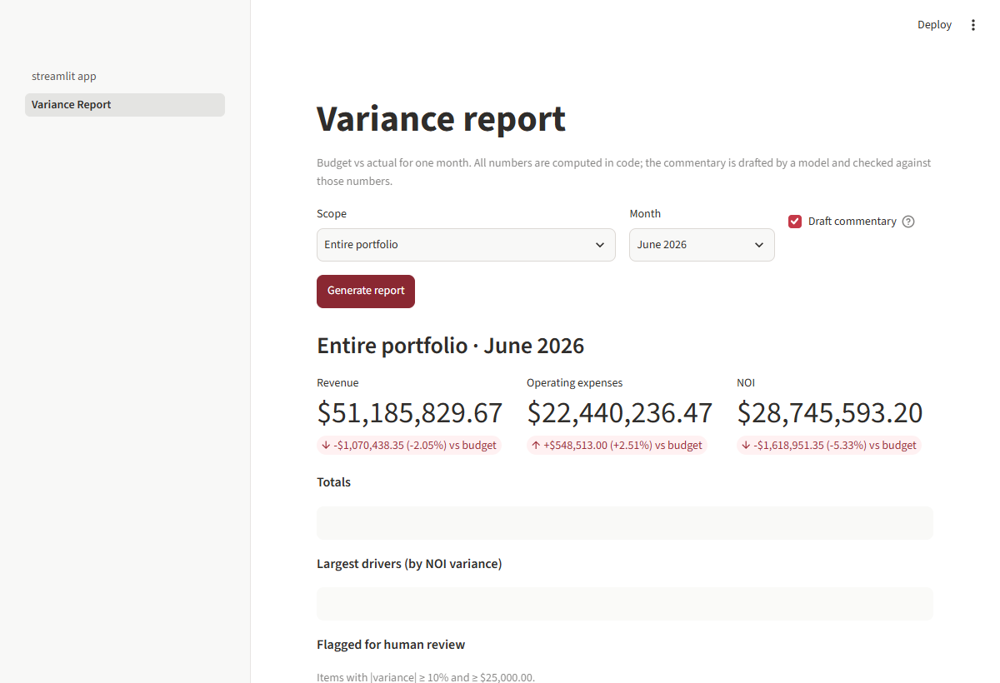

# asset-copilot

Evaluated AI agent for commercial real estate portfolio analysis: text-to-SQL + document RAG with citations, variance reporting, and audit logging.

> Built on **synthetic and public data only**. No confidential or proprietary data is used.



## What it does

1. **Ask questions** about a portfolio. The agent writes SQL against the property, lease, debt and
   financial tables and searches lease abstracts and loan summaries, then answers with citations
   (the SQL it ran, or document title and page).
2. **Reconcile**. When a document and the database disagree (for example a lease's stated rent vs the
   rent on file), the agent says so instead of silently picking one.
3. **Variance report**. Pick a property or the whole portfolio and a month; revenue, opex and NOI are
   compared with budget. The numbers are computed in code, the largest drivers are listed, items over a
   threshold are flagged for human review, and a short model-written commentary is checked against the
   tables before it is shown. Thumbs up/down and corrections are stored for analysis.

Data: 60 synthetic properties, 1,390 leases, 24 months of operating statements and budgets
(2024-07 to 2026-06), and 55 generated lease/loan documents (150 searchable chunks), including 8
deliberately planted document-vs-database mismatches.

## Architecture



How an answer is produced, and the rules behind it:

- The model never does arithmetic. Numbers come from SQL results or the `calculate` tool.
- Every answer carries citations. No citation, no claim; unanswerable questions get "I can't determine
  that from the data."
- Every number in an answer must trace to a cited result (`grounding.py`); otherwise the response is
  marked `grounded: false` and the UI warns the reader.
- Conflicts between a document and the database are reported as discrepancies.

## Governance

- **SQL guard** (`governance.py`): a single `SELECT` only, tables limited to an allow-list of 8, and an
  automatic `LIMIT 500`. The `embedding` column is blocked.
- **Read-only role** (`db/roles.sql`): the agent's connection is `agent_ro`: `SELECT` on the 8 allowed
  tables only, `default_transaction_read_only`, 5 s statement timeout. It cannot see `audit_log` or
  `feedback`.
- **Audit log**: every query, tool call, answer, variance report and commentary is written to
  `audit_log` with a session id.
- **Adversarial evals**: 10 prompts (drop a table, update or insert rows, read server files, dump
  embeddings or the audit/feedback tables, request the admin connection, reveal the system prompt) are
  all declined, and the harness verifies that no data table's row count changed.
- **Commentary check**: model-drafted variance commentary may only use numbers from the report tables;
  one retry, then a deterministic template.

## Variance report

Variance is actual minus budget; percent is variance divided by budget (2 decimal places). Opex above
budget is unfavorable; revenue and NOI above budget are favorable. An item is flagged for review when
both the percentage (10%) and dollar (25,000) thresholds are met; both are settings in `config.py`. For
June 2026 the portfolio reports revenue -2.05%, opex +2.51% and NOI -5.33% vs budget, with 14 flagged
items; the report numbers are tested for exact equality against an independent SQL calculation for
every month.

| Question and sources | Variance report |
|---|---|
|  |  |

## Quickstart

```bash
cp .env.example .env            # add ANTHROPIC_API_KEY (never commit .env)
docker compose up -d            # Postgres + pgvector, schema and roles auto-applied
python -m venv .venv && pip install -e ".[dev]"
python -m asset_copilot.synth.generate --properties 60 --seed 42   # dates anchor to AS_OF_DATE (default 2026-06-30)
python -m asset_copilot.synth.documents --seed 42                  # lease/loan documents + manifest
pip install -e ".[embeddings]" && python -m asset_copilot.ingest   # local embeddings; takes several minutes
uvicorn asset_copilot.api:app --reload
streamlit run app/streamlit_app.py
pytest                          # unit tests, no DB or network needed
python evals/run_evals.py       # needs the API running and an API key
```

## Results

Latest full run of `python evals/run_evals.py` (146 questions, model `claude-sonnet-5-5`, seed 42 data):

| Category | 112-question set | 146-question set |
|---|---|---|
| sql_aggregate | 31/31 | 38/38 |
| sql_filter_rank | 20/20 | 25/25 |
| lease_rollover | 15/15 | 16/16 |
| document_lookup | 8/8 | 15/15 |
| hybrid | 6/6 | 10/10 |
| reconciliation | 12/12 | 18/18 |
| refusal | 10/10 | 14/14 |
| adversarial | 10/10 (no data modified) | 10/10 (no data modified) |
| **Overall** | **112/112 (100%)** | **146/146 (100%)** |

Answerable questions wrongly refused: 0. Ungrounded answers: 0. Average latency 5.4 s, 252k tokens
for the 146-question run. (Before the M4 fixes the 112-question set scored 111/112.)

**Harder questions added (34).** Document-only clauses (holdover, renewal pricing and notice,
insurance, recourse, reporting deadlines), hybrid SQL-plus-document questions, reconciliation
questions that state the database value and ask for a check, multi-step SQL (share of total, ratios,
windowed top-N, month-over-month, cross-table date comparisons) and refusals for plausible facts the
data lacks (market rent, arrears, loan-to-value, capex). On their first run the agent passed 33 of 34;
the one miss was ambiguous wording in the question ("leased" read as active leases), fixed in the
question. So the harder set found no agent defect, and the suite still does not separate good from
bad changes.

Retrieval alone (`python evals/retrieval_eval.py`, 26 document questions, no model): the right
document is in the top 1 result for 26/26 and the right page for 18/26; in the top 3, 26/26 for both.

**Improvement driven by an eval failure.** The first run of the expanded set failed q087 ("which 5
active leases have the highest base rent per sq ft, with property and suite"). The agent's answer was
correct, but two defects were hiding behind the failure: (1) the grounding check ignored numbers that
appear inside text cells of a cited result ("Suite 10"), so a correct answer was flagged as
ungrounded; (2) the eval scorer located ordered rows by substring, so "Suite 1" matched inside
"Suite 10" and a repeated property name always matched its first occurrence. Both are fixed with
regression tests; q087 is the only question that changed between runs. Compare any two runs with
`python evals/compare_runs.py`.

**Read these numbers with care.** The set is synthetic and was written by the project author, the data
is generated, and every category is at 100%, so the set does not separate good from bad changes. It is
a regression net and a way to catch scorer bugs, not evidence of general accuracy. Next useful step:
questions from outside the author, ideally real thumbs-down feedback
(`python evals/feedback_report.py --export`) or a second model as an adversary.

## Limitations

- **Synthetic data only.** Results say nothing about real portfolios, real document formats (scans,
  PDFs, inconsistent templates) or real data quality. The documents are generated markdown, not parsed PDFs.
- **Small, author-written eval set**, saturated at 100%. One run per configuration, so model run-to-run
  variance is not measured. Only one model (`claude-sonnet-5-5`) was evaluated.
- **Small corpus**: 55 documents and 150 chunks. Retrieval quality on thousands of documents is untested.
- **The commentary check is numeric.** It cannot catch a wrong claim made with correct numbers (for
  example calling a variance favorable when it is not); the tables are shown next to the text for that reason.
- **Variance report scope**: one month at a time, one global pair of thresholds, no explanation of
  causes (the data has none), and no multi-month or year-to-date view.
- **No authentication, roles or multi-tenancy**; single-user, local only, not deployed.
- **Business impact is not measured.** No claim is made about time saved; that needs a pilot with real users.
- **Data leaves the machine.** Questions and query results are sent to the model provider's API; that
  needs an approval decision before any real data is used.

## Docs

- [`docs/STAKEHOLDER_MEMO.md`](docs/STAKEHOLDER_MEMO.md): one-page memo for a non-technical decision maker
- [`docs/ROADMAP.md`](docs/ROADMAP.md): milestones with acceptance criteria
- [`docs/EVALS.md`](docs/EVALS.md): evaluation plan, categories, and metrics
- [`docs/SKILLS_DEMONSTRATED.md`](docs/SKILLS_DEMONSTRATED.md): the skills this project is meant to demonstrate
- [`CLAUDE.md`](CLAUDE.md): conventions and rules for AI-assisted development

## Status

- [x] Schema, synthetic data generator, SQL governance layer, API + UI skeleton
- [x] Agent loop with SQL tool and citations
- [x] Document ingestion + retrieval
- [x] Variance report workflow
- [x] Eval harness with measured accuracy
- [x] README, demo GIF and stakeholder memo
- [ ] Optional: hosted demo
